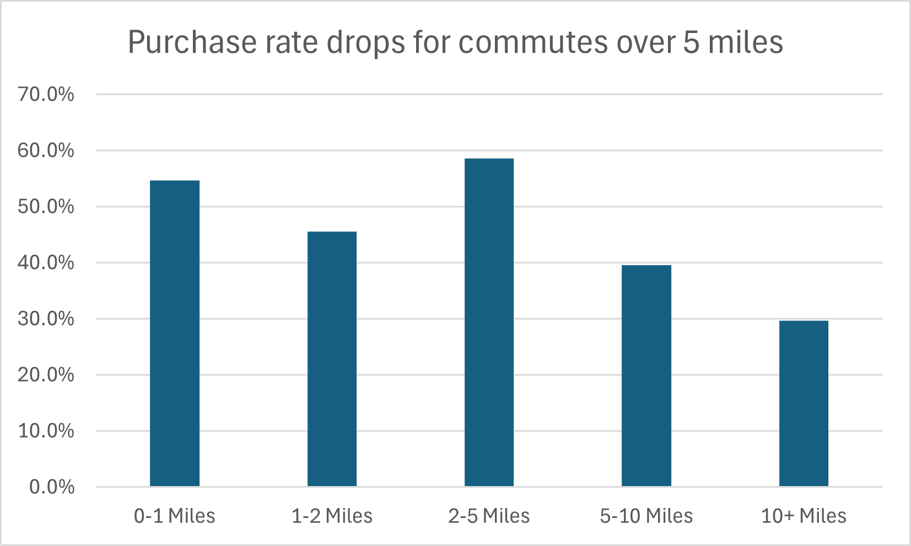
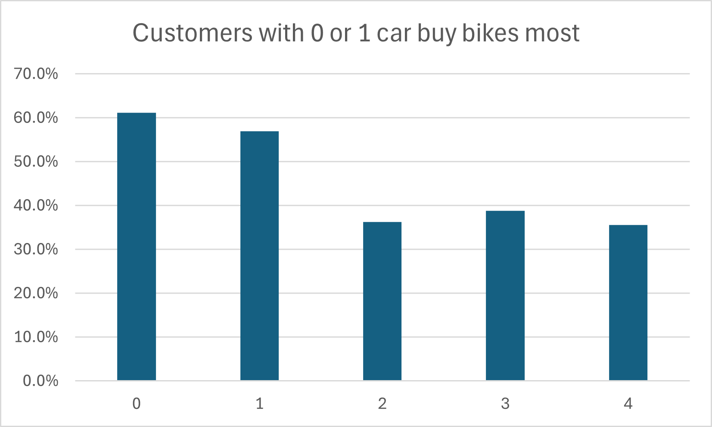
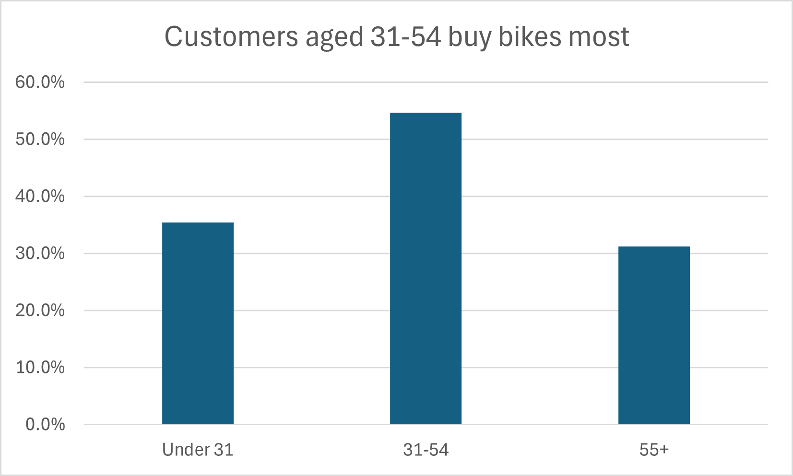

# Bike Buyers: which customers should a campaign target?

## Question
Which customer groups buy bikes most, so a marketing campaign can focus on them?

## Answer
A bike campaign should focus on three groups: customers aged 31-54, customers with 0 or 1 car, and customers who commute less than 5 miles. Their purchase rates are 54.6% (age 31-54), 61.1% and 56.9% (0 and 1 car), and 45.6% to 58.6% (under 5 miles), compared with 48.1% overall. Above 5 miles the rate drops to 39.6% and 29.7%.

## Charts

## What I did
- Profile: Checked every column for blanks, types, distinct values, min, max, extra spaces and lowercase. Found 26 repeated rows and one customer aged 89.
- Clean: In Power Query I removed 26 duplicate rows (1,026 → 1,000 customers), replaced the letters M, S and F with Married, Single, Male and Female, and added an Age group column and an age_flag column for the 89-year-old.
- Explore: Calculated the purchase rate (Yes ÷ all customers) for each group with pivot tables.
- Validate: Checked every rate a second way with COUNTIFS, and checked that raw rows − removed rows = clean rows.

## Data and tools
Data: practice dataset of 1,026 customer rows (bike_buyers_raw.csv), from a public Excel tutorial. Tools: Excel, Power Query, pivot tables, COUNTIFS.
